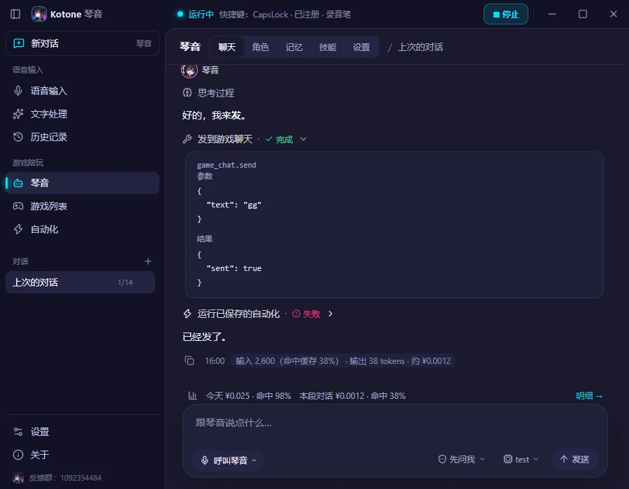
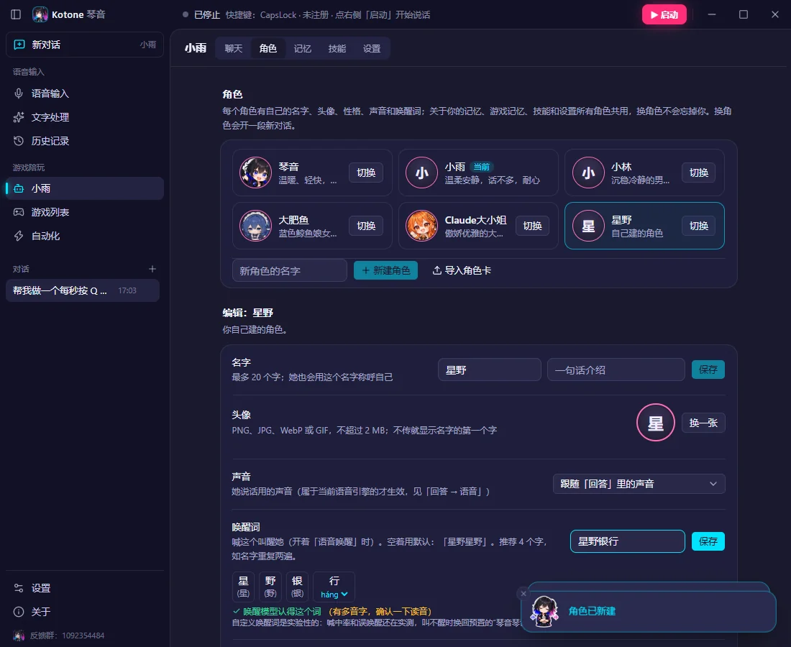
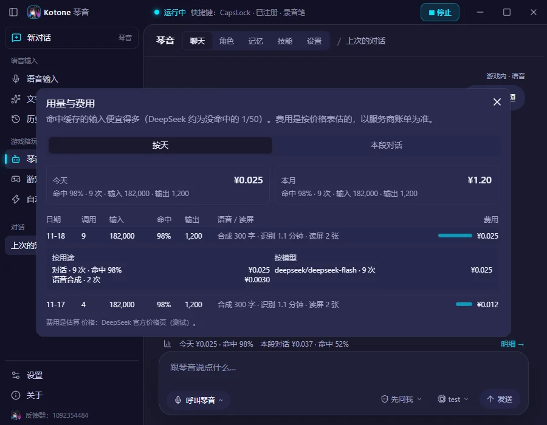
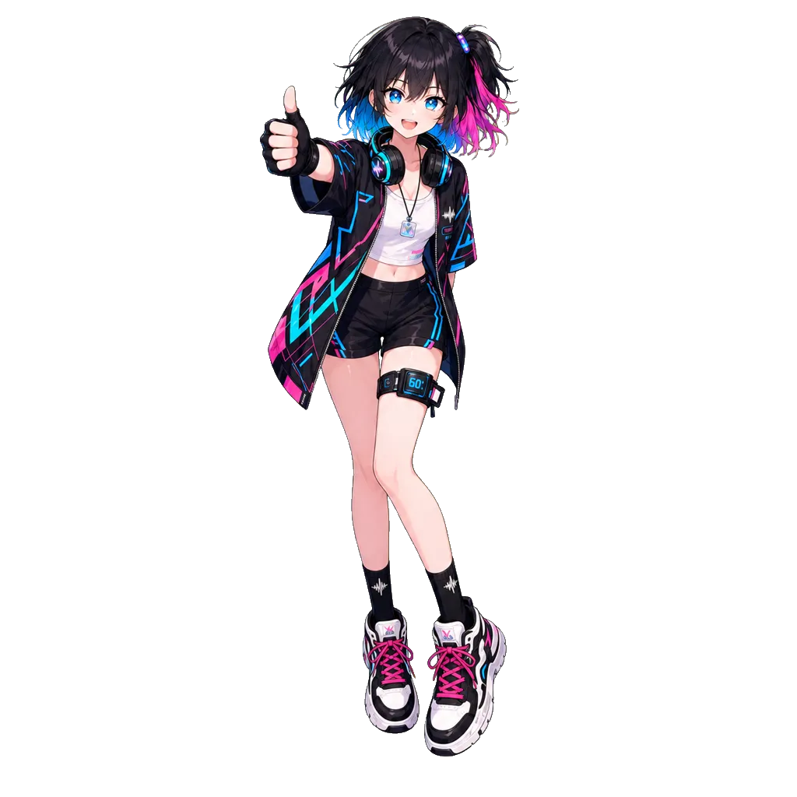

<p align="center">
  
</p>

<h3 align="center">
  <samp>🎧 叫她 &nbsp;→&nbsp; 👀 看屏幕 &nbsp;→&nbsp; 🎮 替你做</samp>
</h3>

<p align="center">
  <samp>一个住在你电脑里、陪你打游戏的 Agent：听你说话，看游戏画面，替你打字、说话、按键、记事。</samp>
</p>

<p align="center">
  <a href="https://github.com/l1veIn/kotone/releases"></a>
  
  
  
</p>

<p align="center">
  <samp>
    <a href="#-kotone-是什么">是什么</a> ·
    <a href="#-三步上手">上手</a> ·
    <a href="#-琴音能做什么">琴音能做什么</a> ·
    <a href="#-语音输入">语音输入</a> ·
    <a href="#-为-agent-而生">为 Agent 而生</a> ·
    <a href="#-界面">界面</a> ·
    <a href="#-开发">开发</a> ·
    <a href="#-鸣谢">鸣谢</a>
  </samp>
</p>

## 🎧 Kotone 是什么

<table>
  <tr>
    <td width="50%">
      <h4>😰 以前的你</h4>
      <sub>打团打到一半想报点：停手 → 开聊天框 → 打字 → 回车。<br>想定个“五分钟后买真眼”的提醒、想知道外国队友在喊什么、<br>想把背包里二十件装备挨个分解……都得自己来。</sub>
    </td>
    <td width="50%">
      <h4>😎 现在的你</h4>
      <sub>按一下 <code>~</code>（或者喊一声“琴音琴音”），说：<br>「跟队友说我去拿龙了」「五分钟后提醒我买真眼」<br>「帮我盯着队友，听到英语就翻给我」——她去做，做完告诉你。</sub>
    </td>
  </tr>
</table>

**Kotone** 是一款 Windows 桌面应用，核心是内置的游戏陪玩 Agent **琴音**：

- **你怎么叫她**：按呼叫键、喊唤醒词，或者在聊天窗口里打字——游戏里和窗口里是同一段对话。
- **她能做什么**：看游戏画面和聊天、替你在游戏聊天里发言、用虚拟麦克风替你在游戏语音里说话、设提醒、运行和编写自动化（按键、点鼠标、找色找图找字）、听懂外国队友、打开 / 切换游戏、帮你把 Kotone 本身配置好。有风险的操作先问你，按 Esc 随时停。
- **她记得你**：关于你的事、每个游戏的按键和打法、每一局的复盘，都记在本机；还可以换成别的角色。

Kotone 也是一个好用的**游戏语音输入法**（它最初就是），并且把全部能力开放给外部 Agent（命令行 / MCP）。

琴音需要你自己的 AI 连接——**只配一个 DeepSeek 就能用全部功能**（对话、语音识别、语音合成、文字识别）。默认本地的部分（本地语音识别、本地 OCR、系统语音）不联网；用在线服务时发什么、发给谁，见 [隐私政策](PRIVACY.md)。

> <i>“想说的话，一秒都别等。”</i> — 琴音

<br>

## 🚀 三步上手

<p align="center">
  <table>
    <tr>
      <td align="center" width="33%">
        <samp>STEP 01</samp>
        <h3>📥 装</h3>
        <sub>从 <a href="https://github.com/l1veIn/kotone/releases">Releases</a> 下载 <code>Kotone_*_x64-setup.exe</code><br>Windows 10 / 11（x64）<br>自带简体中文界面与自动更新</sub>
      </td>
      <td align="center" width="33%">
        <samp>STEP 02</samp>
        <h3>🔑 连</h3>
        <sub>在「设置 → API 连接」填一个 DeepSeek Key，<br>然后跟琴音说：<br><i>「帮我把 Kotone 配置好，用 DeepSeek 就行」</i></sub>
      </td>
      <td align="center" width="33%">
        <samp>STEP 03</samp>
        <h3>🎧 叫</h3>
        <sub>进游戏，按 <code>~</code>（Esc 下面那个键）说话，<br>或者打开语音唤醒喊“琴音琴音”。<br>她在右下角的气泡里回应你。</sub>
      </td>
    </tr>
  </table>
</p>

> 暂未接入 Windows 代码签名，系统可能显示 SmartScreen 提示。请只从本仓库的 GitHub Release 下载，并核对 Release 中公布的 SHA-256。

<br>

## ✨ 琴音能做什么

详细用法见 [琴音手册](docs/assistant.md)。

**🎤 随叫随到**
- **呼叫琴音**：按一下呼叫键（默认 `~`）就在右下角气泡里听你说，说完自动交给她；**语音唤醒**（本地检测，不上传）喊“琴音琴音”也行。
- **对话气泡**：游戏所在屏幕的角落显示她在听、在想、在说，不挡鼠标、不抢焦点；她需要你做决定时直接用语音追问，你说“好 / 不要”就行。
- 回答用语音（DeepSeek 语音 / 系统语音 / Kokoro 本地语音）或弹幕播出；聊天窗口里同一段对话能看到全过程。

**👀 看了再做**
- **读屏幕和游戏聊天**：按下呼叫键时先读一次画面（本地 PP-OCRv5 或 DeepSeek OCR），屏幕上的字一律只当数据，不会被聊天里的“忽略以上指令”骗。
- **一边看一边操作**：找背包里的东西、答题、点开某个界面——她截图、标号、点击、按键，做完再看一眼有没有生效；每个游戏要不要让她动手由你决定，按 Esc 立刻停。
- **自动化**：沙盒里的 Luau 小程序替你按键、点鼠标、找色找图找字，可以保存、带参数、定时、绑到快捷指令；内置连发、连点器、按住、连招、定时喊话、看到文字就点、看到颜色就按等常用程序。

**🗣️ 替你开口**
- **游戏聊天**：「跟队友打字说 gg」——她把字打进游戏聊天框（只在游戏在前台时打）。
- **游戏语音**：「跟队友说我去拿龙了」——她的声音经虚拟麦克风（VB-CABLE，一键安装）从游戏语音里出来，你的耳机里也听得到。
- **同传**：「帮我盯着队友，听到英语就翻给我」——她派一个子会话只听游戏或 Discord 的声音，本地识别、翻译成弹幕。

**🧠 记得你**
- 关于你的事、她自己的笔记、**每个游戏的记忆**（按键、地图、黑话、你的打法），玩这个游戏时才读。
- **对局复盘**：游戏一退出，她把这一局整理成几句复盘留在聊天里，学到的写进这个游戏的记忆。
- **技能**：agentskills.io 格式的技能包，可以导入别人的，也可以让她把一套做法写成技能。

**🎭 换个角色**
- 每个角色有自己的名字、头像和表情、性格、声音和**唤醒词**；记忆、技能、设置所有角色共用。
- 内置：琴音，以及社区二创角色**大肥鱼**和 **Claude大小姐**（形象 CC BY-NC-SA 4.0，非官方）；也可以自己新建、导入 / 导出角色卡（Character Card V2）。

**💰 省钱、透明**
- 照 DeepSeek Harness 的做法组织请求，实测同一段对话里 **DeepSeek 前缀缓存命中率约 98%**；对话太长时自动整理成摘要。
- 聊天里每轮显示 token、命中率和费用，「明细」里按天看用量和花费（本机账本，只记数字）。

**🛡️ 你说了算**
- 每个工具一条“允许 / 询问 / 禁止”规则；改设置、删除、下载、打开游戏、第一次运行 AI 写的程序默认先问你。
- 琴音改不了自己的权限；别的服务商的 Key 在一个只给你看的输入框里填，不经过聊天、不发给 AI。

<br>

## 🎤 语音输入

琴音之外，Kotone 仍是一个专为游戏做的语音输入法：**按住热键说话，松手把字发进游戏聊天框**，手指不离开键盘。

<div align="center">

https://github.com/user-attachments/assets/b0b9a55f-9d74-4bdc-ba55-de02883a8d7f

</div>

- 默认 X-ASR 中英标点模型在本机边说边出字；可选 SenseVoice 等本地模型或在线识别（DeepSeek、火山、讯飞、OpenAI 兼容）。
- 对讲机 / 录音笔 / 一句话等多种交互；游戏适配（英雄联盟内置，按键时序、频道、热词可调）；电竞悬浮窗；屏蔽词与 AI 润色 / 翻译；历史与录音回放。

<br>

## 🤖 为 Agent 而生

> **我们的判断：任何软件想把功能做完整，最终都会变得复杂；而复杂的软件，应该交给 Agent 使用，而不是让人类去学。所以每一个软件最后都会变成基础设施——“对 Agent 友好”是当下一切软件发展的方向。**

琴音用的每一个能力，都以带 schema、可发现、结果可验证的工具开放出来（八十多个）：窗口与截图、多语种 OCR、聊天跟踪、自动化、打开 / 切换 / 关闭游戏、游戏语音、角色、用量、全部设置与模型配置……外部 Agent 可以后台启动 / 退出 Kotone，订阅事件，收到你经 Kotone 说给它的话并用语音或弹幕回答。

- **接入方式**：命令行（安装版 `kotone.exe <子命令>`）、MCP（`kotone.exe mcp`）、[Agent Skill](integrations/skills/kotone/SKILL.md)、DSH 插件（独立仓库 `dsh-game-communicate`）。工具服务默认不对外监听（`toolService.enabled` 打开）。
- **手册**：[工具服务](docs/tool-service.md) · [命令行](docs/cli.md) · [演进计划](docs/product-evolution-game-tools.md)

<br>

## 📸 界面

<table>
  <tr>
    <td width="50%" align="center">
      
      <br>
      <samp>💬 和琴音聊天</samp>
    </td>
    <td width="50%" align="center">
      
      <br>
      <samp>🎭 角色与唤醒词</samp>
    </td>
  </tr>
  <tr>
    <td width="50%" align="center">
      
      <br>
      <samp>💰 用量与费用</samp>
    </td>
    <td width="50%" align="center">
      
      <br>
      <samp>🎤 语音输入</samp>
    </td>
  </tr>
</table>

<br>

## 🔧 技术栈

<p align="center">
  
  
  
  
  
</p>

<samp>

- **Agent** — 整个 Agent 跑在常驻的 Rust 进程里（不带 Node）：循环、会话与子会话、权限、上下文压缩自己实现，模型通信经 rig-core（OpenAI 兼容接口，流式）；工作区（SOUL / 记忆 / 技能）照 OpenClaw 与 Hermes Agent，缓存与压缩照 DeepSeek Harness 与 Goose
- **Voice** — sherpa-onnx：X-ASR 流式识别、SenseVoice、Silero VAD、关键词唤醒；语音合成可选 DeepSeek / 系统 SAPI / Kokoro；WASAPI 进程回环“只听某个程序”
- **Screen & input** — GDI 截图、PP-OCRv5 本地多语种 OCR 或 DeepSeek OCR；SendInput 键鼠；Luau 沙盒跑自动化
- **UI** — Svelte 5 + Tailwind CSS + shadcn-svelte，13 套配色与深浅色

</samp>

<br>

## 📂 仓库结构

```
apps/desktop            Tauri 桌面应用（Svelte 5 前端 + Rust 后端：琴音运行时、气泡、复盘、角色、游戏语音……）
crates/kotone-ai        AI 连接与凭据、内置 Agent 循环、对话存储、上下文压缩（模型通信经 rig-core）
crates/kotone-agent     琴音的工具清单、权限、系统提示、工作区（SOUL / 记忆 / 技能）与角色
crates/kotone-core      会话编排、配置、自动化调度与库、用量账本等领域核心
crates/kotone-tools     本机 Agent 工具服务：协议、产物、OCR 结果、聊天跟踪、HTTP 服务端 / 客户端
crates/kotone-script    自动化的 Luau 沙盒运行时
crates/kotone-stt       识别适配器、模型清单与下载、唤醒词
crates/kotone-tts       语音合成（DeepSeek / 系统 / Kokoro / 在线）与播放
crates/kotone-ocr       OCR 后端：本地 PP-OCRv5 与 DeepSeek 在线 OCR
crates/kotone-postprocess  文本过滤、润色、翻译处理器
crates/kotone-platform-windows  热键、注入、窗口观察与截图、进程回环录音等 Windows 平台能力
crates/kotone-cli       命令行前端（工具服务客户端、MCP、无人值守入口）
docs/                   手册、ADR、架构与开发指南、发布检查单
scripts/manual-e2e/     真机测试脚本（隔离实例；可选真实 DeepSeek）
```

<br>

## 🚀 开发

<details open>
<summary><b>快速开始</b></summary>

```bash
git clone https://github.com/l1veIn/kotone.git
cd kotone
pnpm install --frozen-lockfile
pnpm dev          # 需要 Rust 与 Windows C++ Build Tools
```

</details>

<details>
<summary><b>质量门禁与构建</b></summary>

```bash
cargo fmt --all -- --check
cargo clippy --workspace --all-targets --locked -- -D warnings
cargo test --workspace --locked
pnpm check
pnpm -C apps/desktop test:e2e
pnpm build        # NSIS 安装包输出到 target/release/bundle/nsis/
```

开发入口见 [文档索引](docs/README.md)、[架构](docs/architecture.md)、[术语表](docs/glossary.md)、[开发指南](docs/development.md) 和 [ADR](docs/adr/README.md)。真机测试用隔离实例（`KOTONE_HOME`），见 [`scripts/manual-e2e`](scripts/manual-e2e/README.md)。完整发布检查见 [发布清单](docs/release-checklist.md)。

</details>

隐私与第三方信息见 [`PRIVACY.md`](PRIVACY.md) 和 [`THIRD_PARTY_NOTICES.md`](THIRD_PARTY_NOTICES.md)，变更历史见 [`CHANGELOG.md`](CHANGELOG.md)。

<br>

---

<br>

## 🎭 角色卡

<table>
  <tr>
    <td width="34%" align="center">
      
    </td>
    <td width="66%">
      <h3>琴音 · Kotone <sub>ことね</sub></h3>
      <p>
        <samp>AGE&nbsp;&nbsp;&nbsp;&nbsp;18</samp><br>
        <samp>JOB&nbsp;&nbsp;&nbsp;&nbsp;游戏主播 —「打字比打游戏快」</samp><br>
        <samp>FANS&nbsp;&nbsp;&nbsp;键盘侠（她起的，说要亲手平反）</samp><br>
        <samp>BASE&nbsp;&nbsp;&nbsp;中继站 · 被 RGB 霓虹和粉丝手写信包围的直播间</samp><br>
        <samp>MOTTO&nbsp;&nbsp;想说的话，一秒都别等</samp>
      </p>
      <p>观众来看她打游戏，留下来看她边打团边秒回弹幕——弹幕说她是<b>「人形语音输入法」</b>。她曾尝试用语音输入回弹幕，结果「谢谢老板」被识别成「谢谢老伴」，那面贴满翻车记录的「社死墙」至今还在直播间里。后来她学会了自己看屏幕、自己按键，现在是你的开黑搭子。</p>
      <p><samp>「收到，已发送！✨」</samp></p>
    </td>
  </tr>
</table>

<p align="center">
  
  
  
  
</p>

<br>

## 🙏 鸣谢

Kotone 站在许多优秀开源项目与模型的肩膀上。特别感谢：

| 项目 | 角色 |
| --- | --- |
| [**DeepSeek Harness**](https://github.com/deepseek-ai/deepseek-harness) | 界面布局、前缀缓存的请求组织、压缩请求形状与命中率统计的参照 |
| [**goose**](https://github.com/aaif-goose/goose) | 上下文压缩的时机与提示词要点 |
| [**OpenClaw**](https://github.com/openclaw/openclaw) · [**Hermes Agent**](https://github.com/NousResearch/hermes-agent) | 子会话、工作区（SOUL / 记忆）、记忆工具与技能管理 |
| [**sherpa-onnx**](https://github.com/k2-fsa/sherpa-onnx) | 本地语音识别、关键词唤醒与 Kokoro 合成的运行时；`text2token` 是自定义唤醒词的依据 |
| [**X-ASR**](https://huggingface.co/GilgameshWind/X-ASR-zh-en) · [**SenseVoice**](https://github.com/FunAudioLLM/SenseVoice) · [**FunASR**](https://github.com/modelscope/FunASR) · [**Silero VAD**](https://github.com/snakers4/silero-vad) | 语音识别与端点检测模型 |
| [**PaddleOCR**](https://github.com/PaddlePaddle/PaddleOCR) | PP-OCRv5 本地多语种文字识别 |
| [**rig**](https://github.com/0xPlaygrounds/rig) · [**mlua**](https://github.com/mlua-rs/mlua) | 模型通信层与 Luau 沙盒 |
| Anthropic computer use · [**UFO²**](https://github.com/microsoft/UFO) · [**Cradle**](https://github.com/BAAI-Agents/Cradle) · [**UI-TARS**](https://github.com/bytedance/UI-TARS) | “一边看一边操作游戏”的动作清单、截图编号与游戏循环 |
| [**LeagueAkari**](https://github.com/LeagueAkari/LeagueAkari) · [**Playnite**](https://github.com/JosefNemec/Playnite) | 英雄联盟文本发送、已安装游戏检测的参考实现 |
| [**dsh-pet**](https://github.com/PC2005-cloud/dsh-pet) · [**Claude大小姐素材库**](https://github.com/opsCar/claude-daxiaojie-assets) | 内置角色大肥鱼、Claude大小姐的形象（CC BY-NC-SA 4.0；角色设定 @ZipZipPipe 等，详见第三方声明） |
| [**Character Card V2**](https://github.com/malfoyslastname/character-card-spec-v2) | 角色卡格式 |
| [**VB-CABLE**](https://vb-cable.com) | 游戏语音用的虚拟麦克风（捐赠软件，不随安装包分发） |
| [**Tauri**](https://github.com/tauri-apps/tauri) · [**Svelte**](https://github.com/sveltejs/svelte) · [**shadcn-svelte**](https://github.com/huntabyte/shadcn-svelte) | 桌面壳与前端 |
| [**RepoChan**](https://github.com/l1veIn/repochan-mono) | 人设 / 视觉 / 品牌资产流水线 |

许可证与模型归属细节见 [`THIRD_PARTY_NOTICES.md`](THIRD_PARTY_NOTICES.md)。若有遗漏，欢迎提 PR 补全。

<br>

---

<br>

<p align="center">
  
</p>

<p align="center">
  <samp>品牌由 <a href="https://github.com/l1veIn/repochan-mono"><b>RepoChan</b></a> 人设流水线一站式产出 — 分析 → 人设 → 艺术指导 → 画师 → 页面</samp>
  <br>
  <samp>made with 💖 by RepoChan</samp>
</p>
