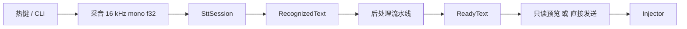

# Kotone 当前架构

本页描述当前代码的职责与不变量。术语以 [glossary.md](glossary.md) 为准；历史方案和测量见 [ADR](adr/README.md) 与 [开发历史](archive/development-history.md)。这里不复制完整 IPC/设置 schema，字段以 Rust 定义、Tauri 命令和 `apps/desktop/src/lib/ipc/contracts.ts` 为准。`ipc.ts` 负责环境分发和命令封装，`ipc/browserMock.ts` 管浏览器实现，`lib/assistant.ts` 是独立助手 IPC。

## 模块边界

| 模块 | 职责 | 依赖约束 |
| --- | --- | --- |
| `kotone-core` | 领域模型、配置/历史/评测、会话编排、识别/注入/后处理等端口 | 不依赖具体 STT、Windows、HTTP 实现或 Tauri；实现由调用方注入 |
| `kotone-tts` | Kokoro 模型推理、音色映射、音频播放与取消 | 实现 core 的 SpeechOutput，复用 sherpa-onnx；独立于 ASR 的 registry 和生命周期 |
| `kotone-stt` | sherpa 流式/非流式、在线 ASR、mock、模型清单和下载、VAD | 依赖 core；模型家族通过配方接入现有运行时，避免每个模型新建引擎 |
| `kotone-platform-windows` | 采音、热键、输入注入、前台窗口与提权、系统语音能力、窗口观察与 GDI 前台客户区捕获、工具服务私有描述文件 | 实现 core 端口，Windows API 与所需 `windows` features 留在此层 |
| `kotone-ai` | 共享 AI 连接、凭据和请求能力；内置 Agent 循环（`agent`：多步工具调用、流式、上限与取消、插话、对话存储；模型通信经 rig-core） | 为后处理、助手与 Agent 提供可复用服务边界；循环只经 `ModelClient` / `ToolPort` 端口认识模型与工具，rig 只出现在 `agent/model.rs`；不承担输入注入或会话 UI |
| `kotone-agent` | 内置 Agent 的 Kotone 专属层：工具清单（工具服务 + 内置动作 + 已保存自动化）、分组与 `tools.find`、权限（允许 / 询问 / 禁止、模式）、系统提示 | 依赖 core / ai / tools，不依赖 Tauri 或 Windows API；播报、提醒、打字与询问界面经 `BuiltinHost` / `Asker` 端口由桌面壳注入 |
| `kotone-script` | 自动化的 Luau 沙盒运行时（白名单函数、步数 / 时长 / 输入上限） | 不依赖 core 或 Windows；键鼠、截图与 OCR 经宿主端口由桌面壳实现 |
| `kotone-postprocess` | 过滤、润色、翻译等具体文本处理器和注册 | 依赖 core/AI 服务；不修改 STT 或 Injector 的职责 |
| `kotone-tools` | 本机 Agent 工具服务：v1 协议信封、能力目录、不可变图像产物存储、预处理、驻留 OCR 结果、聊天消息跟踪、事件总线与用户请求、loopback HTTP 服务端/客户端、实例发现 | 依赖 core 的 `tools`/`ocr` 端口与 HTTP 库，不依赖 Windows API、ONNX 或 Tauri；窗口/捕获/私有文件/OCR 后端与应用级能力（`AppHost`）由调用方注入 |
| `kotone-ocr` | OCR 后端：本地韩文 PP-OCRv5（ONNX Runtime C API）、模型清单/安装/就绪校验、DeepSeek 在线 OCR | 实现 core 的 `ocr` 端口；本地推理（`onnx` feature）链接 sherpa-onnx 预编译包内的 ONNX Runtime，不新增原生库；在线后端只经注入的连接解析获取地址与 key |
| `kotone-cli` | 无 Tauri 命令前端、评测、诊断、自检、工具服务客户端、应用启停（`app`）、stdio MCP 服务器（`mcp`） | 和桌面壳一样组合实现，不复制领域流程；`tools` 子命令只连接已运行的桌面实例，启动由 `app launch` 以不继承句柄的后台进程完成 |
| `integrations/` | Agent 侧交付物：Agent Skill（DSH 插件在独立仓库 `dsh-game-communicate`，与 Kotone 的关系如同 dsh-game-daily 之于 BetterGI） | 只经 `kotone-cli` 与工具服务交互，不链接 Rust crate；业务逻辑留在 Kotone |
| `apps/desktop/src-tauri` | 桌面运行时、IPC、窗口/托盘/更新、事件转发 | 组合核心和实现 crate，负责设备与 UI 生命周期 |
| `apps/desktop/src` | Svelte 设置、向导、悬浮窗和历史 UI | 通过 IPC 请求操作；浏览器 mock 只供 UI 开发和测试 |

## 识别与交付

`RuntimePhase` 管应用启停，`OrchestratorState` 管一句话。识别会话通过 `Listening → Transcribing → Processing → Preview/Sending → Success/Error` 推进；空流水线跳过 `Processing`。流式 partial 用于回显，不作为已定稿文本发送。空转写不注入目标窗口，并提供可理解的失败提示。

会话使用配置快照。取消 token 终止可中断工作，代际标识拒绝过期异步结果；发送必须先取得当前代际的发送权。会话结束释放采音，运行时停止释放驻留模型，不能让清理旧任务破坏新会话。后处理错误保留原文，重试会重新处理；注入错误保留 `ReadyText`，重试不再次请求 AI。`confirm_send()` 无文本参数，预览是只读的。

四种交互预设见术语表。VAD 组件随桌面/CLI 默认特性启用；后端不可用时回落手动停止，solo 不再自动续录，不能把“默认启用”写成永远成功。判停和录音裁剪是不同职责。

## 引擎、模型与评测

`EngineRegistry` 注册运行时策略。sherpa 模型共用 `sherpa-streaming` 或 `sherpa-offline`，由清单的 `recipe` 选择加载方式。旧模型族 ID 仅用于兼容。`activeModelId` 是日常识别选择，不能成为显式评测另一模型时的隐式兜底。

评测在 STT 层解析清单和旧别名，在 core 层消费明确的 `EvalTarget`。CLI 缺省枚举全部已安装本地模型，mock 必须显式选择，在线引擎不进入语料回放。每次回放使用独占评测 registry，先卸载旧 recognizer，再以目标配置预热，并在退出时释放；不得复用桌面识别中的 registry。

结果记录规范引擎 ID、模型 ID、完整会话配置、SHA-256 目标指纹及录音/标注源指纹。缓存只有全部匹配才可复用；旧结果仍可读取/导出，但不参与缓存命中。首字延迟是全速 PCM 回放开始后的计算时间，最终延迟由引擎报告，均不能当作端到端用户体验保证。[评测手册](eval-playbook.md) 给出可复现操作。

## 提醒与输出

提醒是自动化调度器里“晚一会儿开始、只说一句”的程序（ADR 013、045），由她的 `reminder.create`、「自动化」里的“X 秒之后提醒我”或玩家新建的自动化安排；0.1.x 的 `reminders.json` 在第一次启动时只读导入一次。0.1.x 的独立提醒助手（自己的热键、页面、`kotone-ai` 里的受限提醒规划）2026-11-28 去掉（[ADR 052](adr/052-retire-reminder-assistant.md)）；她的会话只由呼叫开始（呼叫键、唤醒词、聊天页的呼叫按钮），助手会话不进入游戏文本后处理 / 注入出口。

提醒和她的回答经桌面端 `deliver_text` 组合语音和弹幕，`SpeechOutput` 默认使用 Windows SAPI，无需下载 Kotone TTS 模型；用户也可选择 `kotone-tts` 的 Kokoro 实现。Kokoro 使用两个 CPU 推理线程、专用串行 worker 和默认声音输出设备，按需加载，空闲 60 秒释放模型；取消代际隔离推理结果，采音前等待播放设备释放。可选模型由用户手动下载，复用 STT 下载设施，独立校验安装到模型目录下的 `speech/`，不进入识别模型列表。缺少引擎配置时使用系统语音，已有显式引擎选择保留。

调度生命周期独立于 ASR 启停，应用退出后不工作；提醒持久化并有到期补投递/错过/失败状态。收音前取消播报，录音持续时语音等待后降级弹幕。弹幕是无底板、鼠标穿透、不抢焦点的右向左单行滚动窗口，速度、字号、距顶部位置、颜色和内置琴音表情可配置。原生 Tauri WebView2 窗口覆盖前台应用所在显示器；前端按逻辑像素及实际内容高度限制垂直位置，尺寸变化仅更新位置，不重启动画。前端动画完成后交还交付权，原生 60 秒超时兜底。对独占全屏不能保证显示，必须记录失败。操作、容量和恢复语义见 [琴音手册](assistant.md) 的“提醒”“到期行为”两节与 [ADR-045](adr/045-automation-is-programs.md)。

## 本机工具服务

可选的 Agent 工具服务（`toolService.enabled`，默认关闭）由桌面 `setup` 在共享状态就绪后启动，`RunEvent::Exit` 关闭；它不经过 `RuntimePhase`，ASR Stopped 时照常可用，也不会因调用而启动 ASR。服务只监听 `127.0.0.1` 随机端口，每个端点校验会话凭证；凭证与地址写入当前用户、当前 Windows 会话私有的描述文件，退出时只删除仍属于本实例的那一份。CLI `tools` 子命令直接连接该服务，不再次运行 `kotone.exe`，避免单实例回调唤起设置窗口抢焦点。

M2 在同一服务内增加 `image.preprocess`、`ocr.backends`、`ocr.recognize` 与 `chat.track.*`。预处理与裁剪一样只生成新产物，`rootTransform` 以“偏移 + 比例”累积，任意放大/裁剪链与 OCR 框都映射回原始捕获的物理像素。OCR 后端经 `kotone-core::ocr` 端口注入：本地后端（模型由 `kotone-cli ocr install` 显式安装、每次加载前校验 SHA-256）与在线后端（只有用户在 `toolService.ocr` 指定连接时就绪，只上传所选产物 PNG）按 ID 显式选择、互不降级。推理在工作线程执行，另有按后端类型划分的有界名额；期限或关闭时取消令牌中断本地推理（ONNX Runtime terminate）或丢弃在线请求，名额直到工作线程真正结束才释放。OCR 结果与跟踪状态只在各自锁内的提交闸门里写入，迟到结果不发布。跟踪器把逐帧观测按位置、时序与来源对齐为稳定 ID、修订与游标事件，频道/说话者只给证据候选，文字作为数据保存，不解释或执行。

Agent 底座第一批把应用本身也交给 Agent：`kotone-cli app launch` 以 `--background` 启动桌面端（只驻留托盘），`app.quit` 等同托盘退出，`runtime.*` 显式启停 ASR。服务内的有界事件总线承载 Kotone → Agent 的反向通道：`assistant.route=agent` 时，助手入口的 `RoutingHandler` 不交给她，而是经 `AppHost` 端口把原文发布为 `user.request`；Agent 领取后用 `agent.reply`，桌面宿主复用提醒交付（输出互斥、等麦克风空闲、弹幕不取焦点）在后台完成，结果以事件回报。`kotone-tools` 只认识 `AppHost` 端口，Tauri 侧的 `DesktopHost` 实现它；交付 future 被丢弃时宿主停止播报、收起弹幕。

窗口引用绑定句柄、PID 与进程创建时间，捕获前重新校验。M1 唯一的捕获后端是 GDI 前台可见客户区：只复制前台目标客户区内屏幕已合成的物理像素，拒绝非前台、最小化、隐藏、跨显示器目标，不退化为整桌面截图，也不宣称隐藏窗口或独占 GPU 内容捕获。产物不可变、只在内存中，带 SHA-256、尺寸、TTL 与到根图的变换；容量与 TTL 有界，调用期限、并发、请求体与像素数均有上限，阻塞工作在工作线程执行，不持有运行时或 UI 锁。协议与工具 schema 以 [工具服务手册](tool-service.md) 和 `capabilities` 为准。

## 本地数据与网络

默认 X-ASR 和可选 sherpa 模型在本机识别；可选 OpenAI-compatible、火山、讯飞适配器会向所选服务发送音频。工具服务的本地 OCR 不联网；在线 OCR 只在用户指定连接且 Agent 显式选择该后端时上传所选图像。启用网络后处理时，识别文本发送到所选连接；本地兼容服务是否继续联网由该服务决定。下载/更新另有独立网络请求。[隐私政策](../PRIVACY.md) 是完整数据边界的权威入口。

配置默认在 `~/.kotone`；模型与历史支持自定义目录。历史原文、可交付文本和可选录音属于用户内容，诊断事件仅记录白名单元数据。评测录档和历史音频默认关闭；普通历史文本是否保存由历史模式决定。AI 连接配置与密钥存储分离；直接 ASR 和旧配置可能含凭据，不能把原始 `config.json` 当成可分享的诊断文件。

## 改动检查点

新增模型优先补清单/配方；新增文本能力优先补处理器；新增服务协议复用连接与凭据层；新增交付方式使用自己的端口，不借道游戏输入。新增 Agent 工具先在 `kotone-tools` 能力目录登记真实 schema，未实现的路线图工具不得出现在 capabilities；新增 OCR 后端实现 `kotone-core::ocr` 端口，不得在失败时静默改用另一后端。跨层修改同时检查取消/超时、配置快照、资源所有权、隐私说明和回归测试。UI、CLI 和后端类型改变时同步核对消费者，不能仅靠浏览器 mock 证明桌面功能可用。
