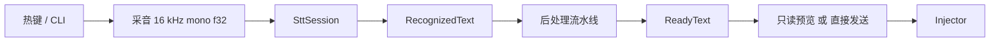

# Kotone 当前架构

本页描述当前代码的职责与不变量。术语以 [glossary.md](glossary.md) 为准；历史方案和测量见 [ADR](adr/README.md) 与 [开发历史](archive/development-history.md)。这里不复制完整 IPC/设置 schema，字段以 Rust 定义、Tauri 命令和 `apps/desktop/src/lib/ipc/contracts.ts` 为准。`ipc.ts` 负责环境分发和命令封装，`ipc/browserMock.ts` 管浏览器实现，`lib/assistant.ts` 是独立助手 IPC。

## 模块边界

| 模块 | 职责 | 依赖约束 |
| --- | --- | --- |
| `kotone-core` | 领域模型、配置/历史/评测、会话编排、识别/注入/后处理等端口 | 不依赖具体 STT、Windows、HTTP 实现或 Tauri；实现由调用方注入 |
| `kotone-tts` | Kokoro 模型推理、音色映射、音频播放与取消 | 实现 core 的 SpeechOutput，复用 sherpa-onnx；独立于 ASR 的 registry 和生命周期 |
| `kotone-stt` | sherpa 流式/非流式、在线 ASR、mock、模型清单和下载、VAD | 依赖 core；模型家族通过配方接入现有运行时，避免每个模型新建引擎 |
| `kotone-platform-windows` | 采音、热键、输入注入、前台窗口与提权、系统语音能力 | 实现 core 端口，Windows API 留在此层 |
| `kotone-ai` | 共享 AI 连接、凭据和请求能力 | 为后处理与助手提供可复用服务边界；不承担输入注入或会话 UI |
| `kotone-postprocess` | 过滤、润色、翻译等具体文本处理器和注册 | 依赖 core/AI 服务；不修改 STT 或 Injector 的职责 |
| `kotone-cli` | 无 Tauri 命令前端、评测、诊断、自检 | 和桌面壳一样组合实现，不复制领域流程 |
| `apps/desktop/src-tauri` | 桌面运行时、IPC、窗口/托盘/更新、事件转发 | 组合核心和实现 crate，负责设备与 UI 生命周期 |
| `apps/desktop/src` | Svelte 设置、向导、悬浮窗和历史 UI | 通过 IPC 请求操作；浏览器 mock 只供 UI 开发和测试 |

## 识别与交付

`RuntimePhase` 管应用启停，`OrchestratorState` 管一句话。识别会话通过 `Listening → Transcribing → Processing → Preview/Sending → Success/Error` 推进；空流水线跳过 `Processing`。流式 partial 用于回显，不作为已定稿文本发送。空转写不注入目标窗口，并提供可理解的失败提示。

会话使用配置快照。取消 token 终止可中断工作，代际标识拒绝过期异步结果；发送必须先取得当前代际的发送权。会话结束释放采音，运行时停止释放驻留模型，不能让清理旧任务破坏新会话。后处理错误保留原文，重试会重新处理；注入错误保留 `ReadyText`，重试不再次请求 AI。`confirm_send()` 无文本参数，预览是只读的。

四种交互预设见术语表。VAD 组件随桌面/CLI 默认特性启用；后端不可用时回落手动停止，solo 不再自动续录，不能把“默认启用”写成永远成功。判停和录音裁剪是不同职责。

## 引擎、模型与评测

`EngineRegistry` 注册运行时策略。sherpa 模型共用 `sherpa-streaming` 或 `sherpa-offline`，由清单的 `recipe` 选择加载方式。旧模型族 ID 仅用于兼容。`activeModelId` 是日常识别选择，不能成为显式评测另一模型时的隐式兜底。

评测在 STT 层解析清单和旧别名，在 core 层消费明确的 `EvalTarget`。CLI 缺省枚举全部已安装本地模型，mock 必须显式选择，在线引擎不进入语料回放。每次回放使用独占评测 registry，先卸载旧 recognizer，再以目标配置预热，并在退出时释放；不得复用桌面识别中的 registry。

结果记录规范引擎 ID、模型 ID、完整会话配置、SHA-256 目标指纹及录音/标注源指纹。缓存只有全部匹配才可复用；旧结果仍可读取/导出，但不参与缓存命中。首字延迟是全速 PCM 回放开始后的计算时间，最终延迟由引擎报告，均不能当作端到端用户体验保证。[评测手册](eval-playbook.md) 给出可复现操作。

## 提醒助手与输出

独立助手语音入口复用已有 ASR 并依赖运行时启动，文字入口不依赖语音启停。`assistant.interactionMode` 使用独立的 `AssistantInteractionMode` 三值类型，默认对讲机，另支持录音笔和说一句就走；旧助手独奏配置读入时兼容为对讲机。录音笔在只读预览确认后提交，其余模式按结束规则提交。页面语音按钮返回所属会话凭据，结束、确认和取消均校验用途、所有权及会话身份，不接管热键或游戏输入会话。助手会话不进入游戏文本后处理/注入出口。`kotone-ai` 将输入文本和工具说明提交给选定连接，模型只能提出受限提醒工具参数；提示词约束提醒对象为用户本人，直接输出简短正文，不附称呼、开场白、第三人喊话或无请求的战术指导。`kotone-core::reminders` 校验并保存计划。

`ReminderDelivery` 组合语音和弹幕，`SpeechOutput` 默认使用 Windows SAPI，无需下载 Kotone TTS 模型；用户也可选择 `kotone-tts` 的 Kokoro 实现。Kokoro 使用两个 CPU 推理线程、专用串行 worker 和默认声音输出设备，按需加载，空闲 60 秒释放模型；取消代际隔离推理结果，采音前等待播放设备释放。可选模型由用户手动下载，复用 STT 下载设施，独立校验安装到模型目录下的 `speech/`，不进入识别模型列表。缺少引擎配置时使用系统语音，已有显式引擎选择保留。

调度生命周期独立于 ASR 启停，应用退出后不工作；提醒持久化并有到期补投递/错过/失败状态。收音前取消播报，录音持续时语音等待后降级弹幕。弹幕是无底板、鼠标穿透、不抢焦点的右向左单行滚动窗口，速度、字号、距顶部位置、颜色和内置琴音表情可配置。原生 Tauri WebView2 窗口覆盖前台应用所在显示器；前端按逻辑像素及实际内容高度限制垂直位置，尺寸变化仅更新位置，不重启动画。前端动画完成后交还交付权，原生 60 秒超时兜底。对独占全屏不能保证显示，必须记录失败。操作、容量和恢复语义见 [提醒助手](assistant.md) 与 [ADR-012](adr/012-reminder-assistant.md)。

## 本地数据与网络

默认 X-ASR 和可选 sherpa 模型在本机识别；可选 OpenAI-compatible、火山、讯飞适配器会向所选服务发送音频。启用网络后处理时，识别文本发送到所选连接；本地兼容服务是否继续联网由该服务决定。下载/更新另有独立网络请求。[隐私政策](../PRIVACY.md) 是完整数据边界的权威入口。

配置默认在 `~/.kotone`；模型与历史支持自定义目录。历史原文、可交付文本和可选录音属于用户内容，诊断事件仅记录白名单元数据。评测录档和历史音频默认关闭；普通历史文本是否保存由历史模式决定。AI 连接配置与密钥存储分离；直接 ASR 和旧配置可能含凭据，不能把原始 `config.json` 当成可分享的诊断文件。

## 改动检查点

新增模型优先补清单/配方；新增文本能力优先补处理器；新增服务协议复用连接与凭据层；新增交付方式使用自己的端口，不借道游戏输入。跨层修改同时检查取消/超时、配置快照、资源所有权、隐私说明和回归测试。UI、CLI 和后端类型改变时同步核对消费者，不能仅靠浏览器 mock 证明桌面功能可用。
